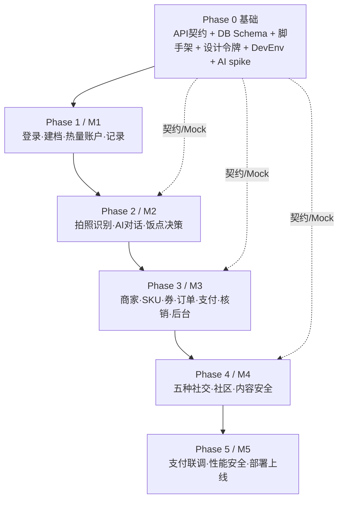

# AI 饮食管控教练 · 完整实施计划（plan.md）

> 依据 `docs/split/` 全套交付文档编写。核心方法：**契约先行 + 多轨并行**——把文档 12 周串行排期拆成 6 个阶段，每阶段内 BE/FE/ADM/DATA/INFRA 五条轨道并行推进，按模块滚动联调，逐里程碑（M1→M5）验收。
>
> 遵循《10-零提问默认决策规则》：不确定就按【假设】选最简方案继续，不停工、不写 TODO 等确认。**能跑 > 完美，先交付可用再迭代。**

---

## 1. 目标与范围

**P0（首期交付）**：微信小程序用户端全部功能 + FastAPI 后端全套服务 + 管理后台（商家端+平台端合并轻量版）+ PostgreSQL/Redis + Docker 部署上线 + 埋点 6 项核心指标。

**P0 功能清单**（§2.1）：微信登录、身体档案、热量账户首页、拍照记录、饮食记录 CRUD、运动记录、步数同步、TDEE 计算、AI 对话（次数限制+邀请扩容）、饭点决策（菜单识别+推荐）、商家列表/详情、标准 SKU 目录、券池（领券/用券）、订单（创建/支付/核销）、体重记录与趋势、提醒订阅、邀请裂变、社区动态与五种社交（基础版）、管理后台、埋点上报。

**不做（P1/P2）**：原生 App、开放平台、多语言、人工教练工单、订阅付费、智能推荐、数据飞轮微调——只预留字段/接口，不实现。

**成功标准**（§9.7 Go-No-Go）：P0/P1 缺陷清零、接口测试 100% 通过、单测 ≥70%、性能与安全达标、50 条冒烟全过、生产稳定 7 天无 P0。

---

## 2. 技术栈与关键决策

| 层 | 选型 |
| --- | --- |
| 用户端 | uni-app（Vue3 + TS）+ Pinia + uni-ui，编译微信小程序 + H5 |
| 管理后台 | Vue3 + TS（H5，独立域名 `/admin`） |
| 后端 | Python 3.12 + FastAPI（uvicorn 多 worker） |
| ORM/迁移 | SQLAlchemy 2.0 + Alembic（只加字段不删改列，保证可回滚） |
| 数据库 | PostgreSQL 16（JSONB + tsvector 全文检索；RAG 向量首期 jsonb 占位） |
| 缓存/队列 | Redis 7（会话、快照、限流、Redis Streams 异步） |
| 存储 | 腾讯云 COS |
| AI | 视觉识别（腾讯云/阿里云图像识别）+ DeepSeek/通义千问（对话+RAG，LangChain） |
| 部署 | Docker Compose + Nginx（Let's Encrypt）+ 腾讯云轻量服务器 + GitHub Actions |
| 规范 | Python ruff+black；前端 eslint+prettier；提交前自动格式化 |

**Phase 0 内须拍板的决策点**（先选最简、可后换）：
1. 前端框架：文档定 uni-app，采用之（备选原生小程序，无强理由不改）。
2. AI Provider：视觉 + LLM 各选一家，W1 spike 定，尽早拿 Key/额度/成本。
3. RAG 向量：首期 jsonb 占位 + 全文检索兜底，不引 Milvus/pgvector。
4. 微信支付：JSAPI；无正式商户号前用沙箱/Mock 打通，W11 联调替换。
5. 管理后台部署：默认随后端 Docker；需快速预览可评估 qoder-sites 托管静态 H5（仅 admin）。

---

## 3. 交付物与目录结构（monorepo，对齐 §10.2）

```
/ai-coach
  /backend    FastAPI（app/：api、services、models、schemas、core、tasks）
  /miniapp    uni-app 小程序（pages、components、stores、api、styles）
  /admin      Vue3 管理后台
  /deploy     docker-compose.yml、Dockerfile.*、nginx.conf、CI 脚本
  /data       建表 SQL、种子（食物库/SKU/RAG）、测试用例
  /docs       交付文档（已存在）
  plan.md
```

---

## 4. 核心策略：契约先行 + 多轨并行

并行前提是**先冻结共享契约**，之后五轨全程并行，只在"集成联调"汇合：
1. **API 契约**：§8 的 34 接口 → OpenAPI 3.1 + pydantic schema → 生成 TS 类型 + Mock Server（Prism/msw）。前端对 Mock 开发，后端实现真接口，互不阻塞。
2. **DB Schema**：§7 建表 SQL → Alembic 初始迁移，全后端共用。
3. **设计令牌**：§4 Design Tokens → `uni.scss`/CSS 变量 + 基础组件库。



> 阶段之间是**主依赖**（后一阶段依赖前一阶段的地基），但每个阶段**内部五轨并行**；且 DATA/INFRA 两轨贯穿全程、与所有阶段并行。前后端在同一阶段内对同一批接口"Mock→真接口"滚动联调。

---

## 5. 阶段总览

| 阶段 | 里程碑 | 周 | 主题 | 退出标准 |
| --- | --- | --- | --- | --- |
| Phase 0 | 准备 | W1 | 环境、契约、脚手架、设计令牌、AI spike | `compose up` 起全套、Mock 返回 34 接口、前端壳登录进首页 |
| Phase 1 | M1 基础 | W2–W4 | 登录、建档、热量账户、饮食/运动记录、步数校准、体重、订阅 | 账户数字对拍手算表误差 0、拍照写入环形图 <1s |
| Phase 2 | M2 AI | W4–W6 | 拍照识别、AI 对话+RAG+次数、饭点决策 | AI 答 10 类问题、识别 ≥85%、次数尽提示邀请 |
| Phase 3 | M3 商家 | W7–W8 | 商家/SKU/价格区间/LBS、券、订单/支付/核销、管理后台 | 下单→支付→核销全通、券不重复核销、越界价 400 |
| Phase 4 | M4 社交 | W9–W10 | 五种社交、社区、动态、榜单、内容审核 | 五种社交可用、内容安全拦截生效 |
| Phase 5 | M5 收尾 | W11–W12 | 支付联调、性能/安全测试、埋点、文档、部署上线 | 过 Go-No-Go、生产 7 天无 P0 |

---

## 6. Phase 0 · 基础周（W1）

**目标**：产出可跑开发环境 + 三件套契约。**8 个子任务第 1 天即可并行**。

| 编号 | 任务 | 依赖 | 交付物 |
| --- | --- | --- | --- |
| P0-a | Monorepo、git flow（main/develop/feature）、`.env.example`、ruff/black/eslint/prettier | 无 | 仓库骨架、提交规范 |
| P0-b | 设计令牌 → `uni.scss`/CSS 变量 + 基础组件（按钮/卡片/表单/Toast/骨架屏，§4） | 无 | 组件库雏形 |
| P0-c | 建表 SQL → Alembic 初始迁移 + 种子加载脚本骨架（§7） | 无 | migration、data/ |
| P0-d | **API 契约**：34 接口 OpenAPI + pydantic schema + TS 类型生成 + Mock Server | 无（最高优先） | openapi.yaml、mock |
| P0-e | 后端脚手架：app factory、config、异步 DB session、Redis、统一响应/异常、JWT+微信 code2session、限流中间件、request_id JSON 日志 | P0-c/d 草案 | 可跑 FastAPI |
| P0-f | 前端脚手架：uni-app 工程、Pinia、请求封装（token 刷新）、路由守卫、5 Tab+FAB、通用状态组件（§5.8） | P0-b/d 草案 | 可跑小程序壳 |
| P0-g | docker-compose（pg+redis+api+nginx）+ CI 骨架（lint+test） | P0-a | 一键起环境 |
| P0-h | **AI spike**：视觉+LLM provider 选型验证、hello-world、确认 Key/额度/成本 | 无 | 选型结论 + SDK 封装 |

**并行说明**：P0-a/c/d/g/h 立即并行；P0-d 出草案（约 D2）后 P0-b/e/f 接入并行。
**退出标准**：全套服务起得来、Mock 通、前端壳能登录进首页、AI spike 出结论。

---

## 7. Phase 1 · M1 基础（W2–W4）

**目标**：跑通"建档→记录→热量账户"核心闭环。**准入**：Phase 0 完成。

### Track BE（后端）
| 编号 | 任务 | 交付物 | 依赖 |
| --- | --- | --- | --- |
| BE1 | 认证/用户/档案/权益：login（code2session→JWT access2h+refresh7d）、me、body-profile POST/GET、user_benefit 初始化 | 可登录建档 | P0-e |
| BE2 | 热量引擎：BMR（Mifflin-St Jeor）、预算=BMR×PAL、TEF=摄入×10%、EAT、NEAT、TEE、缺口=摄入−TEE；daily_snapshot 0 点生成+幂等；account/today、account/trend | 账户计算服务 | BE1 |
| BE2b | 步数校准：steps/sync；逐时步频→MET（散步2.5/快走4.3/跑步8.0），NEAT_calibrated 与状态法加权（步数0.6/状态0.4） | 校准服务 | BE2 |
| BE3 | 记录：meal POST/PUT/DELETE/list（写后重算当日摄入）、sport POST/list、food/search（tsvector+alias） | 记录 CRUD | BE1、DATA1 |
| BE-w | 体重：weight_record CRUD + 趋势 | 体重服务 | BE1 |
| BE-n | 提醒订阅：订阅消息（餐前 11:00/17:00、深夜防崩塌）+ Redis Streams 调度 | 通知服务 | BE1 |

### Track FE（前端，对 Mock）
| 编号 | 任务 | 交付物 | 依赖 |
| --- | --- | --- | --- |
| FE1 | login、profile/edit（性别/身高/体重/年龄/目标/活动水平，分段控件）、index 首页（评分环+热量环形图+摄入/运动明细+核心指标+趋势入口+AI卡占位+快捷服务+券提醒+FAB）、account 详情 | App 外壳+首页 | P0-f |
| FE2 | record/camera（拍照→识别→确认/修正分量→写入）、record/food-list（CRUD+合计）、record/sport、record/sport-add | 记录页 | FE1 |
| FE-w | 体重记录 + 趋势图 | 体重页 | FE1 |
| FE-s | 通用状态（加载骨架/空/错误/无权限/未开通权益）落地各页 | 状态组件 | FE1 |

### Track DATA
- DATA1：**食物库 1700+ 条 + food_alias（W3 前交付，BE3/后续识别依赖）**
- DATA4：热量测试用例 50 行 Excel（W4，对拍 BE2）

### Track INFRA/QA
- INFRA1：CI 接入单测+接口测试；INFRA2：部署 staging
- QA：热量计算单测对拍（5 活动水平×男女×各餐）、步数校准单测（0/3000/8000/12000/20000 步）、建档边界（身高0/200、体重0/500、年龄负数）

**并行说明**：BE1 完成后 BE2/BE3/BE-w/BE-n 并行；FE1 完成后 FE2/FE-w/FE-s 并行；BE 与 FE 全程对 Mock 并行，按"账户""记录"两个模块分别联调。
**退出标准（M1）**：建档后首页环形图 = BMR×PAL−已摄入+运动−TEF **误差 0**；拍照写入后环形图与明细同步 **<1s**；步数为 0 用 PAL 估算、>0 走校准。

---

## 8. Phase 2 · M2 AI（W4–W6）

**目标**：拍照识别 + AI 对话 + 饭点决策。**准入**：Phase 0 AI spike 定案；DATA1/DATA3 就绪；BE3 记录接口可用（识别结果需写入）。

### Track BE
| 编号 | 任务 | 交付物 | 依赖 |
| --- | --- | --- | --- |
| BE4a | 视觉识别：meal/recognize（图片→COS→视觉API→匹配 food 表→置信度<0.7 需确认），返回 items+need_confirm | 识别接口 | P0-h、DATA1 |
| BE4b | AI 对话：ai/chat（LangChain+RAG 检索 ai_knowledge；系统提示词固定"AI饮食教练/只答体重管理/疾病引导就医"）、ai/times；扣减 ai_times_left，不足返 4001；不可用降级预置 FAQ；限流 20/min/用户 | 对话+RAG | P0-h、DATA3 |
| BE4c | 饭点决策：ai/recommend（菜单拍照→推荐最优组合+绿/黄/红健康等级→一键记录） | 推荐接口 | BE4a、BE2 |

### Track FE
| 编号 | 任务 | 交付物 | 依赖 |
| --- | --- | --- | --- |
| FE3 | eat 吃什么页：AI帮我找（拍照/语音）、识别结果、AI推荐卡（绿/黄/红+选这个记下来）、今天还剩 kcal、标准减脂餐、附近商家比价占位、专家问诊占位 | 吃什么页 | FE1、BE4c |
| FE6 | ai/chat 对话页：问答、剩余次数、次数尽"邀请好友解锁"、饥饿急救弹窗 | AI 对话页 | FE1、BE4b |
| FE-a | 首页 AI 教练卡接真数据（问教练/饥饿急救入口） | AI 卡 | FE1、BE4b |

### Track DATA
- DATA3：**RAG 知识库语料 + 预置 FAQ（W5 前交付）**
- DATA4：识别测试图 30 张（食堂/外卖/便利店各 10）

### Track INFRA/QA
- QA：识别准确率 ≥85%（30 图）、AI 答 10 类常见问题、AI 对话 P95<3s 超时降级、次数用尽拦截

**并行说明**：BE4a/BE4b 可并行（识别 vs 对话），BE4c 依赖 BE4a；FE3/FE6/FE-a 并行对 Mock。
**退出标准（M2）**：AI 答 10 类问题、识别测试集 ≥85%、次数用完输入框上方显示"今日剩余 0 次，邀请好友解锁"且无法发送、AI 超时不卡死走 FAQ。

---

## 9. Phase 3 · M3 商家与交易（W7–W8）

**目标**：商家上品定价 → 用户下单支付核销全闭环 + 管理后台。**准入**：BE1 认证、BE5 前置的 merchant/sku 表就绪。

### Track BE
| 编号 | 任务 | 交付物 | 依赖 |
| --- | --- | --- | --- |
| BE5 | 商家：merchant/list（LBS 距离/评分/可用券排序）、merchant/{id}、sku/catalog；定价校验 price BETWEEN min/max 越界 400；权重分（拉新40%+券40%+过程20%） | 商家/目录服务 | BE1、DATA2 |
| BE6 | 交易：order 创建（服务端重算 pay_amount=total−discount，不信前端）、order/{id}/pay（微信 JSAPI 预下单）、order/notify（验签+幂等+防金额篡改+防重复回调）、order/{id}/redeem（核销码唯一/一次性，校验归属商家/未用/未过期/达门槛，重复返 5004）、order/list、coupon/list；订单 15 分钟超时取消并释放券；券池 coupon_pool | 交易闭环 | BE5 |
| BE9 | 管理 API：admin/dashboard、目录/商家入驻审核/价格区间/券池/订单/内容管理 | 后台 API | BE5、BE6 |

### Track FE
| 编号 | 任务 | 交付物 | 依赖 |
| --- | --- | --- | --- |
| FE4 | merchant/detail（SKU/券/预约/核销）、order/confirm（选SKU、区间校验、选券不可用灰显+原因）、order/list（待支付/待核销/已完成）、coupon 券包（吃/动/异业/过期）；调起支付；到店出示核销码 | 交易页 | FE1、BE6 |

### Track ADM（管理后台 H5，独立应用，对 Mock）
| 编号 | 任务 | 交付物 |
| --- | --- | --- |
| ADM1 | 脚手架 + 管理员登录（admin_user，账号密码/验证码） | 后台框架 |
| ADM2 | 商家后台：选品、区间定价（越界前端提示 ¥X-¥Y）、选券、上下架、核销、数据 | 商家端 |
| ADM3 | 平台后台：标准目录、商家入驻审核、价格区间、券池、订单监控、数据看板 | 平台端 |

### Track DATA
- DATA2：标准 SKU 目录种子（标准减脂餐/运动项目 + 价格区间）

### Track INFRA/QA
- QA：交易 E2E（下单→支付→核销）、券（过期/未达门槛/非本商家/重复使用）、商家定价（上/下边界/越界必 400）、支付篡改 pay_amount/重复回调金额不变不重复发货

**并行说明**：BE5→BE6 有依赖但 BE9 可与 BE6 并行；FE4 与 ADM2/ADM3 对 Mock 并行；ADM 作为独立应用与小程序前端完全并行。
**退出标准（M3）**：下单→支付→核销全链路跑通、核销码只能一次（重复返回"已核销"5004）、商家越界价后端 400、支付金额服务端重算不被篡改。

---

## 10. Phase 4 · M4 社交（W9–W10）

**目标**：五种社交 + 社区 + 内容安全。**准入**：BE1、BE7 相关表就绪。

### Track BE
| 编号 | 任务 | 交付物 | 依赖 |
| --- | --- | --- | --- |
| BE7a | 动态：community_post（发帖/晒图/点赞/评论、匿名、audit_status） | 动态服务 | BE1 |
| BE7b | 五种社交：supervise（互看记录/提醒打卡/匹配搭子）、community_group（长期打卡/活动）、battle（LBS 匹配/加入/关联场馆券）、challenge+challenge_join（限时赛/进度/排行榜/徽章）、热量控制榜、同款减友经验 | 社交服务 | BE1、BE5 |
| BE7c | 内容安全：微信 msgSecCheck+imgSecCheck，违规入审核队列；AI 周点评 | 审核服务 | BE7a |

### Track FE
| 编号 | 任务 | 交付物 | 依赖 |
| --- | --- | --- | --- |
| FE5 | community（榜单/监督/兴趣社群/约战/挑战赛/动态）、community/supervise、community/group、community/battle、community/challenge、community/post（发帖/点赞/评论） | 社区页 | FE1 |

### Track ADM
- 内容审核队列（违规内容处理）

### Track INFRA/QA
- QA：内容安全（违规词/违规图触发拦截）、XSS 转义、M1–M3 回归

**并行说明**：BE7a/BE7b/BE7c 并行；FE5 各子页并行对 Mock；ADM 审核与 BE7c 对接。
**退出标准（M4）**：五种社交均可用、内容安全拦截生效、动态违规内容进审核不直接展示。

---

## 11. Phase 5 · M5 收尾与上线（W11–W12）

**目标**：支付真机联调、性能/安全/兼容测试、埋点、文档、生产部署灰度。**准入**：M1–M4 全部通过。

| 编号 | 任务 | 轨道 | 交付物 |
| --- | --- | --- | --- |
| F1 | 微信支付真实商户号联调、支付/核销 Bug 修复 | BE | 支付可用 |
| F2 | 接口冻结、热修 | BE | 稳定 API |
| F3 | 全站打磨、异常态全覆盖、埋点 6 项核心指标（7日留存/K因子/扫码转化/识别成功率/AI满意度/获客成本） | FE | 体验+埋点 |
| F4 | 管理后台打磨 | ADM | 后台可用 |
| F5 | 性能测试：单接口 P95<300ms（查询）/<800ms（写+重算）、首屏<1.5s、AI<3s、100 并发 5 分钟错误率<1% 无内存泄漏、百万行分页<500ms | QA | 性能报告 |
| F6 | 安全测试：越权（A token 访问 B 返 1002）、SQL 注入、XSS、接口重放（1 秒 10 次仅首次成功）、支付篡改 | QA | 安全报告 |
| F7 | 兼容测试：iPhone SE/iPad/主流安卓、微信 8.x+最新；后台 Chrome/Edge/Safari + 1920/1440/375 | QA | 兼容报告 |
| F8 | 冒烟 50 条、Go-No-Go 评审 | QA | 放行决议 |
| F9 | 生产部署、灰度、监控告警生效（Prometheus+Grafana、JSON 日志、AI 成本告警）、复盘 | INFRA | 上线+看板 |

**并行说明**：F5/F6/F7 测试并行；F1/F3/F4 修复打磨并行；F9 部署在 F8 放行后执行。
**退出标准（M5）**：Go-No-Go 全过、生产环境稳定运行 7 天无 P0、监控告警生效。

---

## 12. 周 × 轨道并行矩阵（把串行周计划并行化）

| 周 | BE 后端 | FE 小程序 | ADM 后台 | DATA 数据 | INFRA/QA |
| --- | --- | --- | --- | --- | --- |
| W1 | 脚手架+认证+Schema | 脚手架+设计系统+外壳 | 选型 | 食物库采集启动、SKU | 仓库/compose/CI、AI spike |
| W2 | JWT/微信登录、建档、热量账户 | 登录、建档、首页环形图 | 脚手架+登录 | 食物库继续 | CI 接入测试 |
| W3 | 食物导入、拍照识别、饮食 CRUD、步数同步 | 拍照记录、饮食列表、运动 | — | **交付食物库**、识别图 | 部署 staging |
| W4 | TDEE/步数校准、体重趋势、订阅提醒 | 账户详情、添加运动、体重趋势 | — | 热量用例 50 行 | 热量单测对拍、M1 验收 |
| W5 | AI 对话、RAG、次数限制 | AI 对话页 | 商家后台 | **交付 RAG 知识库** | AI 集成测试 |
| W6 | 饭点决策、AI 教练卡、异常处理 | 吃什么页 | 平台后台(一) | FAQ/降级语料 | M2 验收 |
| W7 | 商家/目录/SKU/价格区间、LBS、券池 | 商家详情、券包 | 平台后台(二) | SKU 种子 | 商家接口测试 |
| W8 | 订单、支付、核销、看板 API | 订单确认/列表、支付 | 订单/内容/看板 | — | 交易 E2E、M3 验收 |
| W9 | 动态、监督、社群、挑战赛 | 社区（五种社交） | 内容审核 | — | M1–M3 回归 |
| W10 | 约战、榜单、AI 点评、内容审核 | 动态详情、榜单、约战 | 看板完善 | — | 内容安全测试、M4 验收 |
| W11 | 支付联调、Bug 修复 | 打磨、异常态、埋点 | 打磨 | — | 性能+安全+兼容测试、文档 |
| W12 | 冻结、热修 | 冻结 | 冻结 | — | 生产部署、灰度、Go-No-Go、复盘 |

---

## 13. 关键路径

`P0(a/c/d/e/h)` → `BE1 认证` → `BE2 热量引擎 + BE3 记录` → `FE1 首页联调`（M1）→ `BE4 AI`（M2）→ `BE5→BE6 商家/交易`（M3）→ `BE7 社交`（M4）→ `F5/F6 性能安全 + F1 支付联调` → `F9 生产部署灰度`（M5）。

最长杆：热量引擎（BE2）与 AI（BE4）技术风险最高，需最早投入并预留对拍/调优时间；DATA1 食物库、DATA3 RAG 是关键路径上的数据前置，必须 W3/W5 前交付。

---

## 14. 集成与联调策略

- **按模块滚动联调**：每完成一对（BE 模块 + FE 模块）即把该页 Mock 切真接口做集成测试，不积压到最后。
- **联调检查点**：热量数值对拍（BE2↔FE1）、拍照识别闭环（BE4↔FE2/3）、下单支付核销（BE6↔FE4↔ADM2）、内容安全（BE7↔FE5）。
- **契约变更纪律**：改接口先改 OpenAPI → 重新生成 TS 类型 → 通知对端，禁止前后端各改各的。

---

## 15. 测试策略（§9）

- 单元（pytest，服务层+计算逻辑，≥70%）：热量/TDEE/步数校准/价格区间/券核销/邀请防刷。
- 接口（pytest+httpx）：34 接口全覆盖 + 错误码（1001/2001/3001/4001/5002/5004/6001/7001）。
- 前端（Vitest + uni-app 测试库）；E2E（微信开发者工具自动化 + Playwright 测 H5/后台）。
- 专项：兼容、性能、安全（越权/注入/XSS/重放/支付篡改）。
- 验收对拍：热量 50 行 Excel 误差 0、识别 30 图 ≥85%。
- Bug 分级：P0 24h、P1 3 天、P2 下迭代、P3 排期。

---

## 16. 部署策略（§10）

- 开发：本地 docker-compose；测试：腾讯云 2C4G + 独立 PG/Redis；生产：腾讯云 4C8G + 云 PG + 云 Redis + COS + CDN。
- Nginx：80→443、Let's Encrypt 自动续期、`/api/`→FastAPI、`/admin/`→静态、`/uploads/`→媒体、静态缓存 7 天/HTML 不缓存、限流 100r/s。
- 迁移/回滚：Alembic 先测后 prod、执行前备份、执行后校验行数；镜像打 git short sha；只加字段保证可回滚。
- 监控/日志/告警：Prometheus+Grafana（QPS/延迟/错误率/热量计算耗时/AI 成本）；JSON 日志含 request_id、落盘+Cron 上传 COS 保留 30 天；不可用 5 分钟/错误率>5%/磁盘>80%/AI 超预算 → 告警。

---

## 17. 风险与缓解

| 风险 | 影响 | 缓解 |
| --- | --- | --- |
| AI Provider 未定/Key/额度/成本 | 阻塞 Phase 2 | W1 spike 定案；不可用降级 FAQ（DATA3） |
| 微信支付商户号未就绪 | 阻塞 Phase 3 支付联调 | 沙箱/Mock 打通，W11 替换真实商户号 |
| 食物库/RAG 数据量大耗时 | 阻塞识别/问答 | DATA 轨 W1 起并行，W3/W5 前交付；识别<0.7 用户确认兜底 |
| 前后端契约漂移 | 联调返工 | OpenAPI 单一真源，改接口先改规范再生成类型 |
| 热量口径不一致 | M1 对拍失败 | BE2 与 DATA4 用例同源，单测误差 0 才过 |
| 范围过大 | 进度风险 | 严守 P0，P1/P2 只留字段/接口 |

---

## 18. 立即下一步（Phase 0 启动清单）

1. 建 monorepo 目录 + git flow + `.env.example` + lint 工具链（P0-a）。
2. §7 建表 SQL → Alembic 初始迁移 + 种子脚本骨架（P0-c）。
3. §8 的 34 接口 → OpenAPI + pydantic schema → 生成 TS 类型 + 起 Mock Server（**P0-d，最高优先，解锁并行**）。
4. §4 设计令牌 + 基础组件（P0-b）。
5. 后端脚手架（P0-e）+ 前端脚手架（P0-f）。
6. docker-compose 开发环境 + CI 骨架（P0-g）。
7. AI provider 选型 spike（P0-h）。
8. DATA 轨道并行启动食物库/SKU/RAG 采集。

> 完成即具备"五轨并行"条件，随后按 Phase 1→5 推进，每阶段内并行、按模块滚动联调、逐里程碑验收。
